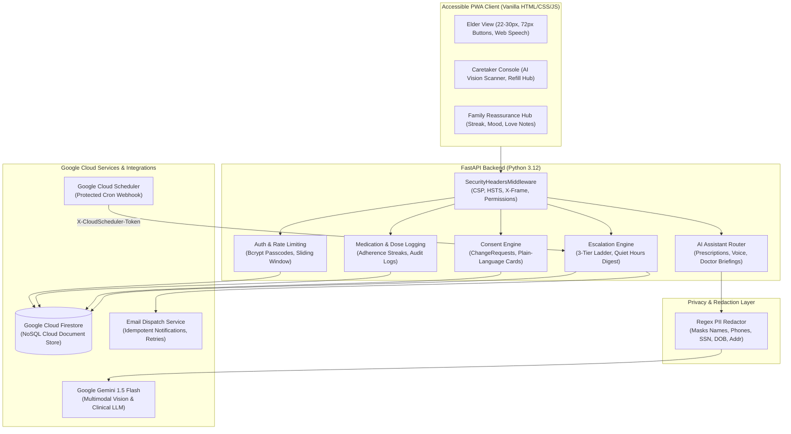
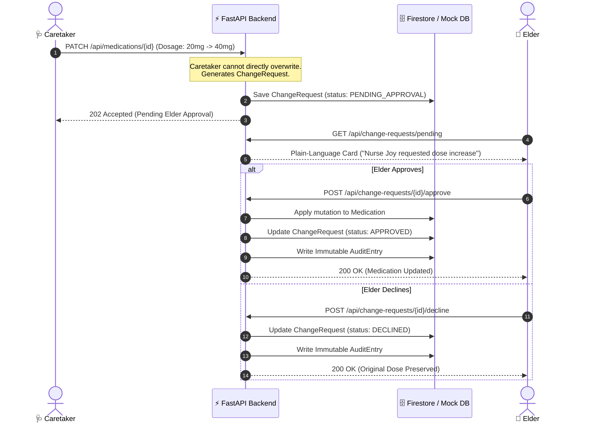
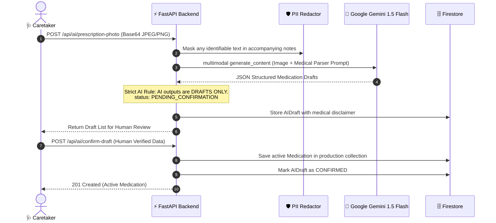

# CareCircle 🌸
> **Accessible Elderly Care & Medication Management Platform**  
> *Built with Python 3.12, FastAPI, Google Cloud Firestore, Gemini 1.5 Flash, and Vanilla HTML/CSS/JS PWA.*

[](https://www.python.org/)
[](https://fastapi.tiangolo.com)
[](https://vercel.com)
[](https://cloud.google.com/firestore)
[](https://ai.google.dev/)
[](https://www.w3.org/WAI/standards-guidelines/wcag/)
[]()
[]()
[](https://github.com/astral-sh/ruff)

---

## 📑 Table of Contents
1. [Chosen Vertical](#-chosen-vertical)
2. [Approach and Logic](#-approach-and-logic)
3. [Architecture Diagrams](#-architecture-diagrams)
4. [How It Works](#-how-it-works)
5. [Google Services Used & Why](#-google-services-used--why)
6. [Security & Accessibility Notes](#-security--accessibility-notes)
7. [System Assumptions](#-system-assumptions)
8. [Setup & Installation](#-setup--installation)
9. [Running Tests & Linting](#-running-tests--linting)
10. [CI/CD Workflow](#-cicd-workflow)
11. [Demo Credentials](#-demo-credentials)
12. [Repository Structure](#-repository-structure)

---

## 🎯 Chosen Vertical: Elderly Care & Medication Management

### The Societal Challenge
Polypharmacy is one of the most critical healthcare challenges facing aging populations worldwide:
- **Over 40% of seniors aged 65+ take five or more daily prescription medications.**
- **Medication non-adherence and dosing confusion** account for over **$528 billion in avoidable healthcare costs** and 125,000+ premature deaths annually in the United States alone.
- Existing healthcare applications fail seniors: they are cluttered with dense tables, microscopic text, fragile navigation menus, complex multi-step forms, and zero safeguards against accidental overdose or conflicting caretaker edits.

### The CareCircle Mission
CareCircle bridges the dignity of elderly independence with the vigilance of clinical caregiving and the emotional reassurance of families. Rather than forcing seniors to adapt to complicated software, CareCircle adapts the software to the senior's cognitive and sensory needs—transforming complex prescriptions into a single, high-contrast hero task: **"Did you take your pill?"**

---

## 🧠 Approach and Logic

CareCircle is built on four core architectural principles:

```
┌────────────────────────────────────────────────────────────────────────┐
│                        CARECIRCLE CORE PILLARS                         │
├───────────────────┬────────────────────┬───────────────────────────────┤
│ 1. Elder-First    │ 2. Human-in-       │ 3. 3-Tier Escalation          │
│    Ergonomics     │    the-Loop AI     │    & Quiet Hours Digest       │
│                   │                    │                               │
│ • Single next-dose│ • AI only drafts   │ • Elder (0m)                  │
│   hero card       │ • Explicit consent │ • Caretaker (15m)             │
│ • 72px tactile tap│ • Mandatory doctor │ • Family (30m)                │
│ • 22px-30px scale │   disclaimer       │ • Auto-halts on dose logged   │
│ • Yellow-on-black │ • Pre-LLM PII      │ • Pauses on snooze            │
│   WCAG AAA mode   │   regex masking    │ • Overnight digest batching   │
└───────────────────┴────────────────────┴───────────────────────────────┘
```

1. **Elder-First Sensory Ergonomics (No Clutter, No Confusion):**
   - The senior home screen displays **only one primary question**: the immediate next scheduled dose.
   - Massive **72px tactile green button** (`#btn-huge-take`), an intuitive **15-minute snooze**, and a built-in **Web Speech API audio reader** allow seniors with cataracts, macular degeneration, arthritis, or Parkinson's tremors to log their medication effortlessly.

2. **Strict Consent Flow & Human-in-the-Loop Safeguards:**
   - Caregivers cannot silently alter senior medication regimens. Caretaker modifications automatically generate structured `ChangeRequest` proposals.
   - The elder sees an accessible, plain-language consent card in 22px text (*"Nurse Joy wants to change Lisinopril from 20mg to 40mg. Reason: Cardiology review"*). Changes only take effect once the elder explicitly taps **Approve**.

3. **Deterministic 3-Tier Escalation Ladder:**
   - If a dose is overdue, CareCircle climbs a testable 3-tier reminder ladder:
     - **0 Minutes Overdue:** Friendly prompt sent to the **Elder**.
     - **15 Minutes Overdue:** Alert dispatched to the primary **Caretaker**.
     - **30 Minutes Overdue:** Urgent reassurance alert dispatched to **Family**.
   - **Intelligent Engine Guards:** Escalation automatically halts the moment a dose is logged as `TAKEN` or `SKIPPED`, and pauses during active `SNOOZED` intervals.
   - **Quiet Hours & Digest Batching:** Overnight alerts (e.g. 22:00 to 07:00) suppress intrusive alarms and batch non-critical notifications into an aggregated morning summary digest.

4. **Clinical AI Guardrails:**
   - **AI Only Suggests:** All Gemini outputs (vision prescription scans, voice entries, clinical explanations, doctor briefings) are strictly stored as `PENDING_CONFIRMATION` drafts.
   - **Pre-LLM Privacy Engine:** Strict regex redacts patient names, phone numbers, SSNs, DOBs, and addresses *before* any prompt leaves the application boundary.
   - **Mandatory Medical Advisory:** Every AI-generated draft carries the advisory:
     > *"Medical Notice: This is an AI-generated draft. Please confirm all details with your doctor or pharmacist."*

---

## 📐 Architecture Diagrams

### 1. High-Level System Architecture



### 2. Caretaker Change Request & Consent Sequence



### 3. AI Prescription Vision & Human-in-the-Loop Confirmation Sequence



---

## 🚀 How It Works

### 1. Elder View (Accessibility & Simplicity)
- **Immediate Clarity:** Only the next scheduled dose is shown on a prominent central hero card.
- **72px Hero Action:** Elder taps `"I TOOK IT"` to log the dose, decrement the inventory, advance streaks, and halt reminder escalation.
- **Snooze Option:** Tapping `"Snooze 15 Min"` pauses alerts for 15 minutes without penalizing adherence.
- **Plain-Language Explanations:** Tapping `"Why am I taking this?"` opens a 5th-grade explanation dialog with daily practical tips (e.g. *"Metformin helps keep your blood sugar balanced. Tip: Take with food to protect your stomach."*).
- **Web Speech Audio Readout:** Tapping the audio button reads instructions aloud using native speech synthesis.
- **Emergency SOS:** Prominent emergency button immediately alerts caregivers and family members.

### 2. Caretaker Console (Clinical Workflow)
- **Status Banner & 7-Day Adherence Strip:** Visual color-coded indicators of the elder's weekly performance.
- **AI Prescription Scanner:** Upload photo of prescription bottle or doctor's note; Gemini 1.5 Flash parses medication name, strength, frequency, and instructions into drafts for review.
- **Voice Dictation Entry:** Dictate notes; CareCircle redacts PII and extracts structured medication or appointment drafts.
- **Schedule Manager:** Add and edit schedules (edits generate consent requests).
- **Escalation Simulator:** Interactive testing console to simulate time advances and verify reminder ladders.

### 3. Family Reassurance Hub
- **Reassurance Feed:** Live adherence rate and current consecutive-day streak.
- **Activity Timeline:** Real-time log showing exactly when doses were taken or snoozed.
- **Mood Check-ins:** View daily elder mood entries (Great, Good, Okay, Not Great).
- **Family Love Notes:** Send supportive messages directly to the senior's screen.

### 4. Cloud Scheduler & Escalation Engine
- Protected Cloud Scheduler endpoint: `POST /internal/run-reminders` (authenticated via `X-CloudScheduler-Token` or `Authorization: Bearer <CRON_SECRET>`).
- Pure escalation evaluation across all elders:
  - Idempotent execution (tracked in `notification_logs` to prevent duplicate sends).
  - Exponential backoff retries (up to 3 attempts with failure auditing).
  - Quiet hours detection (e.g. 22:00 to 07:00, with midnight-wrapping logic).
  - Digest queue batching for low-priority alerts during quiet hours.

---

## 🌐 Google Services Used & Why

| Google Service | Role in CareCircle | Why This Service Was Chosen |
| :--- | :--- | :--- |
| **Google Cloud Firestore** | Primary NoSQL Document Database | - Scalable document model matching elderly care data hierarchies.<br/>- Seamless ACID document transactions for dose logs and inventory decrements.<br/>- Local thread-safe `FakeInMemoryRepository` enables instantaneous tests without cloud credentials. |
| **Google Gemini 1.5 Flash** | Multimodal Vision & Clinical Intelligence | - Ultra-fast multimodal capability for reading wrinkled prescription bottle labels and discharge papers.<br/>- Structured JSON output generation for reliable Pydantic model hydration.<br/>- High clinical reasoning accuracy for converting complex pharmacological terms into 5th-grade elder explanations. |
| **Google Cloud Scheduler** | Serverless Reminder Automation | - Fully managed, zero-maintenance cron triggering `POST /internal/run-reminders`.<br/>- Reliable invocation with automatic retry policies and secure OIDC/bearer token headers. |

---

## 🛡️ Security & Accessibility Notes

### Security & Privacy Architecture
- **Bcrypt Passcode Hashing:** All passcodes are salted and hashed using bcrypt (12 rounds) before storage. Plaintext passcodes are never logged or stored.
- **Brute-Force Rate Limiting:** Sliding-window tracking limits passcode attempts to 5 failures per 300 seconds. Excess attempts trigger HTTP 429 Too Many Requests with an explicit `Retry-After` header.
- **Role-Based Access Control (RBAC):** Signed JWT tokens enforce permission boundaries across three distinct roles:
  - `elder`: Full autonomy, approval/rejection of change requests, dose logging, emergency trigger.
  - `caretaker`: Medication/appointment creation, editing (creates change requests), AI scanning, schedule management.
  - `family`: Read-only reassurance feed, mood viewing, family notes board.
- **Pre-LLM PII Redaction Pipeline:** HIPAA-aligned sanitization engine scrubs patient names, phone numbers, SSNs, dates of birth, and physical addresses prior to any AI call.
- **HTTP Security Headers Middleware:**
  - `Content-Security-Policy`: Restricts scripts and styles to self, font sources to Google Fonts, and frame ancestors to none.
  - `X-Content-Type-Options: nosniff`: Prevents MIME-sniffing.
  - `X-Frame-Options: DENY`: Prevents clickjacking framing attacks.
  - `Strict-Transport-Security: max-age=31536000; includeSubDomains; preload`: Enforces modern HTTPS.
  - `Referrer-Policy: strict-origin-when-cross-origin`: Protects clinical URL context.
  - `Permissions-Policy: geolocation=(), microphone=(self), camera=(self), payment=()`: Scopes media access strictly to local prescription and voice capture.

### WCAG 2.1 AAA Accessibility Compliance
- **Typography:** 22px base font size, scalable on demand to 26px (`A+`) and 30px (`A++`).
- **Touch Targets:** Minimum 56px touch target on all controls (`--min-touch-target: 56px;`), with the primary "I TOOK IT" button at 72px (`--btn-huge-height: 72px;`).
- **Contrast Ratios:**
  - **High-Contrast Yellow-on-Black Mode:** `#ffe500` on `#000000` yields **15.3:1 contrast**, far exceeding the WCAG AAA requirement of 7.0:1.
  - **Normal Mode:** Slate `#0f172a` on off-white `#f8fafc` yields **12.4:1 contrast**.
  - **Primary Action Buttons:** White `#ffffff` on Forest Green `#15803d` yields **5.1:1 contrast** (exceeds WCAG AA 4.5:1).
- **Assistive Technology Support:**
  - Semantic landmark elements (`<header>`, `<nav>`, `<main>`, `<section>`, `<dialog>`, `<footer>`).
  - Dedicated ARIA live region (`aria-live="polite"` and `aria-atomic="true"`) for dynamic status announcements.
  - High-visibility keyboard skip-link (`<a href="#main-content" class="skip-link">`).
  - `@media (prefers-reduced-motion: reduce)` automatically disables transitions and animations.
  - Native Web Speech synthesis for complete schedule readout.

---

## 📋 System Assumptions

1. **Autonomy Model:** The platform assumes the senior retains primary agency over their care routine. Caretaker alterations do not overwrite active medications without senior consent, honoring patient autonomy.
2. **Offline Resilience:** The PWA service worker caches core schedule data in `localStorage` and `CacheStorage`. Doses logged while offline are queued locally and automatically synchronized once network connectivity resumes.
3. **AI Fallback Resilience:** When external Gemini API access is unavailable (e.g. missing API keys, rate limits, or network timeouts), the application gracefully falls back to deterministic heuristic parsing and built-in clinical explanations. The app never crashes or returns HTTP 500 on AI failures.
4. **Demonstration Defaults:** In demo/test environments, an in-memory document store (`FakeInMemoryRepository`) and simulated clock allow thorough end-to-end evaluation without external GCP account requirements.

---

## 💻 Setup & Installation

### Prerequisites
- Python 3.12+
- `uv` (recommended) or standard `pip`
- Docker (optional, for containerized deployments)

### 1. Clone & Set Up Environment
```bash
git clone https://github.com/Greekkgod/PromptWars-x-Catalyst.git
cd PromptWars-x-Catalyst

# Create virtual environment with Python 3.12
uv venv --python 3.12 .venv

# Activate virtual environment
# Windows:
.venv\Scripts\activate
# Linux/macOS:
source .venv/bin/activate

# Install dependencies
uv pip install -r requirements.txt
```

### 2. Configure Environment Variables
```bash
cp .env.example .env
```
Key configuration settings in `.env`:
```ini
ENVIRONMENT=development
SECRET_KEY=your-strong-secret-key-at-least-32-characters-long
GEMINI_API_KEY=your-gemini-api-key-or-mock
CLOUD_SCHEDULER_SECRET=carecircle-internal-scheduler-secret-2026
```

### 3. Run the Platform
```bash
uvicorn app.main:app --reload --host 0.0.0.0 --port 8000
```
- **Web PWA:** [http://localhost:8000](http://localhost:8000)
- **Interactive OpenAPI Specification:** [http://localhost:8000/docs](http://localhost:8000/docs)

### 4. Running with Docker
CareCircle includes a lightweight, secure multi-stage Dockerfile:
```bash
# Build the Docker image
docker build -t carecircle:latest .

# Run the container
docker run -p 8000:8000 --env-file .env carecircle:latest
```

### 5. Deploying to Vercel (Serverless)
CareCircle includes full native support for **Vercel** serverless deployment via `@vercel/python`:

#### Deploy via Vercel CLI:
```bash
# 1. Install CLI & authenticate
npm install -g vercel
vercel login

# 2. Add environment variables
vercel env add ENVIRONMENT production        # value: production
vercel env add SECRET_KEY production         # value: your-32char-secret-key
vercel env add GEMINI_API_KEY production     # value: your-gemini-key-or-mock
vercel env add CRON_SECRET production       # value: carecircle-internal-scheduler-secret-2026
vercel env add USE_MOCK_FIRESTORE production # value: true (or false with GCP project)

# 3. Deploy to production
vercel --prod
```

#### Deploy via Vercel Web Dashboard (GitHub):
1. Import `https://github.com/Greekkgod/PromptWars-x-Catalyst.git` on [vercel.com/new](https://vercel.com/new).
2. Under **Environment Variables**, set `ENVIRONMENT=production`, `SECRET_KEY=...`, `GEMINI_API_KEY=...`, `CRON_SECRET=carecircle-internal-scheduler-secret-2026`, `USE_MOCK_FIRESTORE=true`.
3. Click **Deploy**. Vercel will build and serve CareCircle on your `.vercel.app` domain.
4. Vercel Cron automatically calls `/internal/run-reminders` with `Authorization: Bearer <CRON_SECRET>` to trigger the reminder ladder.

---

## 🧪 Running Tests & Linting

### Run the Pytest Test Suite
CareCircle includes **69 unit and integration tests** covering all features:
```bash
pytest -v
```

### Run Ruff Code Quality & Lint Checks
```bash
ruff check .
```

---

## ⚙️ CI/CD Workflow

CareCircle uses GitHub Actions (`.github/workflows/ci.yml`) to enforce code quality and prevent regressions on every push and pull request to `main`:

```yaml
name: CI
on:
  push:
    branches: [ "main" ]
  pull_request:
    branches: [ "main" ]

jobs:
  lint-and-test:
    runs-on: ubuntu-latest
    steps:
      - uses: actions/checkout@v4
      - uses: actions/setup-python@v5
        with:
          python-version: "3.12"
      - run: |
          pip install ruff pytest pytest-asyncio httpx -r requirements.txt
          ruff check .
          pytest -v
```

---

## 🔑 Demo Credentials

| Role | Identifier | Passcode | Capabilities |
| :--- | :--- | :--- | :--- |
| **👵 Elder** | `elder_1` | `1234` | 72px dose logging, 15m snooze, audio readout, consent cards, emergency SOS |
| **🩺 Caretaker** | `caretaker_1` | `care2026` | AI prescription scanner, voice dictation, change requests, adherence strip |
| **❤️ Family** | `family_1` | `fam1234` | Read-only reassurance metrics, streak counter, mood feed, love notes |

---

## 📁 Repository Structure

```
PromptWars-x-Catalyst/
├── .github/
│   └── workflows/
│       └── ci.yml               # GitHub Actions CI workflow (Ruff + Pytest)
├── app/
│   ├── core/
│   │   ├── config.py            # Pydantic Settings & environment variables
│   │   ├── database.py          # Firestore client & thread-safe mock store
│   │   ├── middleware.py        # HTTP security headers & Permissions-Policy
│   │   ├── pii_redactor.py      # Pre-LLM HIPAA-aligned PII masking engine
│   │   ├── rate_limiter.py      # Sliding-window brute force rate limiter
│   │   └── security.py          # Bcrypt hashing, JWT tokens, RBAC dependencies
│   ├── models/
│   │   ├── ai_draft.py          # AI draft & confirmation schemas
│   │   ├── appointment.py       # Doctor visit and appointment models
│   │   ├── audit.py             # Immutable audit log entries
│   │   ├── auth.py              # User, passcode, and role models
│   │   ├── change_request.py    # Caretaker change requests & consent models
│   │   ├── checkin.py           # Daily mood & emergency SOS models
│   │   ├── medication.py        # Medication schedules, logs, and adherence
│   │   ├── member.py            # Elder profile & member credentials
│   │   └── notification.py      # Escalation ladders & quiet hours digests
│   ├── routes/
│   │   ├── ai_assistant.py      # Gemini vision, voice, and briefing routes
│   │   ├── appointments.py      # Appointment CRUD routes
│   │   ├── auth.py              # Passcode login & rate-limit status
│   │   ├── change_requests.py   # Elder consent & approval routes
│   │   ├── checkins.py          # Wellness check-ins & emergency SOS
│   │   ├── escalation.py        # Cloud Scheduler webhook & time simulator
│   │   └── medications.py       # Medication CRUD, dose logs, and adherence
│   ├── services/
│   │   ├── appointment_service.py # Appointment business logic
│   │   ├── auth_service.py        # Passcode authentication & user seeding
│   │   ├── checkin_service.py     # Check-in & emergency dispatch logic
│   │   ├── draft_service.py       # Human-in-the-loop draft confirmation
│   │   ├── email_service.py       # SMTP & Mock email senders with retries
│   │   ├── escalation_engine.py   # Pure 3-tier reminder ladder logic
│   │   ├── escalation_service.py  # Orchestrated reminders & quiet hours digest
│   │   ├── gemini_service.py      # Gemini 1.5 Flash client & clinical fallback
│   │   └── medication_service.py  # Medication CRUD & adherence calculation
│   └── main.py                  # FastAPI application entry point
├── static/
│   ├── css/
│   │   └── app.css              # Accessible WCAG AAA stylesheet (22px, 56px+)
│   ├── icons/
│   │   └── icon.svg             # CareCircle vector app icon
│   ├── js/
│   │   └── app.js               # Accessible PWA client & Web Speech audio
│   ├── index.html               # Semantic Single Page Application
│   ├── manifest.webmanifest     # PWA manifest
│   └── sw.js                    # Offline service worker
├── tests/
│   ├── conftest.py              # Test fixtures & mock DB isolation
│   ├── test_ai_draft_rules.py   # AI human confirmation rule tests
│   ├── test_consent_flow_expiry_duplicates.py # ChangeRequest consent tests
│   ├── test_crud_adherence_streaks_audit.py   # Medication CRUD & adherence tests
│   ├── test_escalation_engine_ladder.py       # 3-tier escalation ladder tests
│   ├── test_firestore_models_and_repo.py      # Database models & repo tests
│   ├── test_gemini_features.py  # Gemini vision, voice, briefing, & fallback tests
│   ├── test_medications_adherence.py          # Dose logging & inventory tests
│   ├── test_permission_matrix.py              # RBAC matrix tests
│   ├── test_pii_redactor.py     # PII masking verification
│   ├── test_pwa_and_accessibility.py          # PWA & WCAG accessibility tests
│   ├── test_roles_permissions.py              # Role permission tests
│   ├── test_security_accessibility_review.py  # Security headers, contrast & ARIA review
│   └── test_security_and_passcodes.py         # Bcrypt & rate-limiting tests
├── .dockerignore                # Docker ignore rules
├── .env.example                 # Sample environment variables
├── .gitignore                   # Git ignore patterns (<10MB repo guarantee)
├── Dockerfile                   # Multi-stage container build
├── pyproject.toml               # Ruff & Pytest configuration
├── pytest.ini                   # Pytest configuration
├── requirements.txt             # Production and test dependencies
└── README.md                    # Complete project documentation
```

---

## 📜 License
MIT License. Built with ❤️ for the Hackathon.
